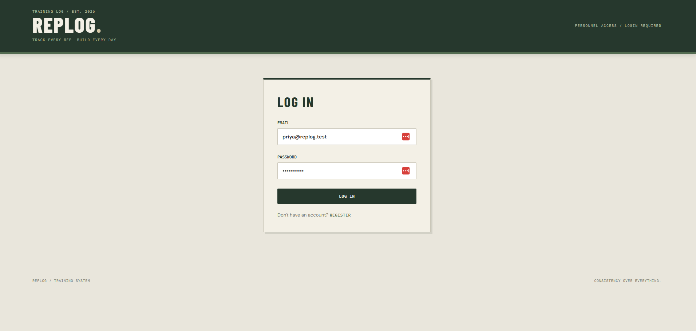
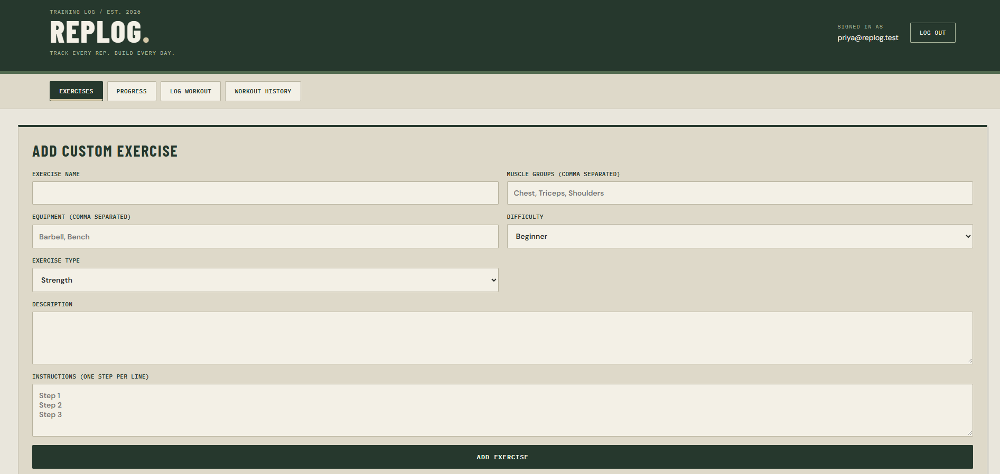
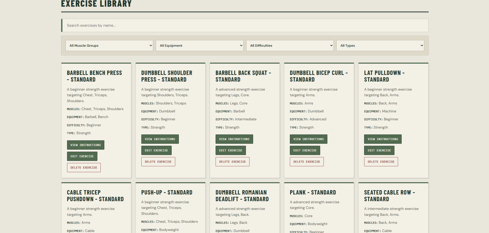
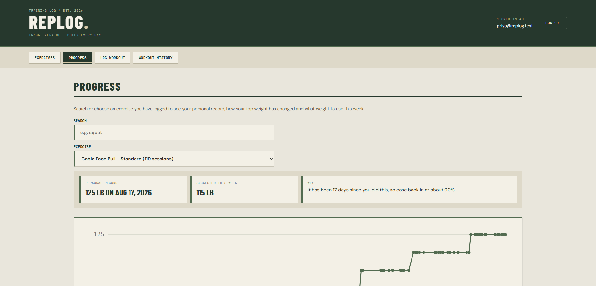
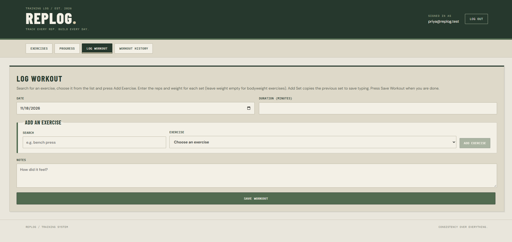
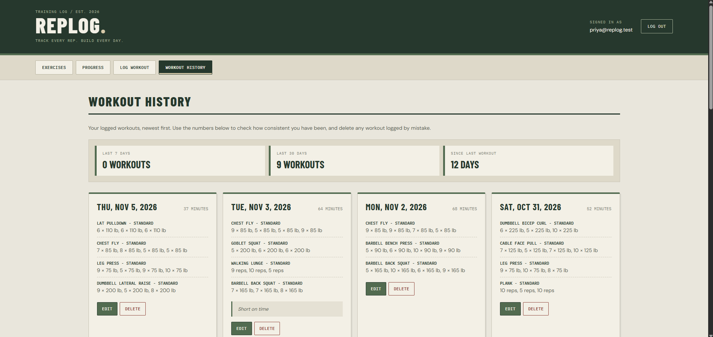

# RepLog: Track Every Workout

## Authors

Anthony Minichillo and Alex Dat Huynh

## Class Link

[Class name](PASTE-CLASS-LINK-HERE)

## Project Objective

RepLog is a workout logging web app. Users browse and filter an exercise
library, log workouts (sets, reps, weight, duration), and track personal
records and progress over time.

## Screenshot

## Instructions to Build

1. Clone the repo.
2. Backend: `cd backend && npm install`
3. Copy `backend/.env.example` to `backend/.env` and fill in your values
   (`MONGO_URI`, `DB_NAME`, `SESSION_SECRET`, `PORT`).
4. Seed the database: `npm run seed`
5. Seed the demo users and workouts: `npm run seed:workouts`
6. Start the backend: `npm start`
7. Frontend: `cd frontend && npm install && npm run dev`

## How to Use

1. Register an account or log in with the test login below.
2. **Exercises:** search and filter the exercise library and view
   instructions for any exercise.
3. **Log Workout:** add exercises, enter the reps and weight for each set and
   press Save Workout.
4. **Workout History:** review past workouts, and edit or delete any of them.
5. **Progress:** choose an exercise to see your personal record, a chart of
   your progress and a suggested weight for this week.

## Test Login

- Email: `priya@replog.test`
- Password: `password123`

(Also available with the same password: `marcus@replog.test`,
`jordan@replog.test`)

## License

[MIT](LICENSE)
